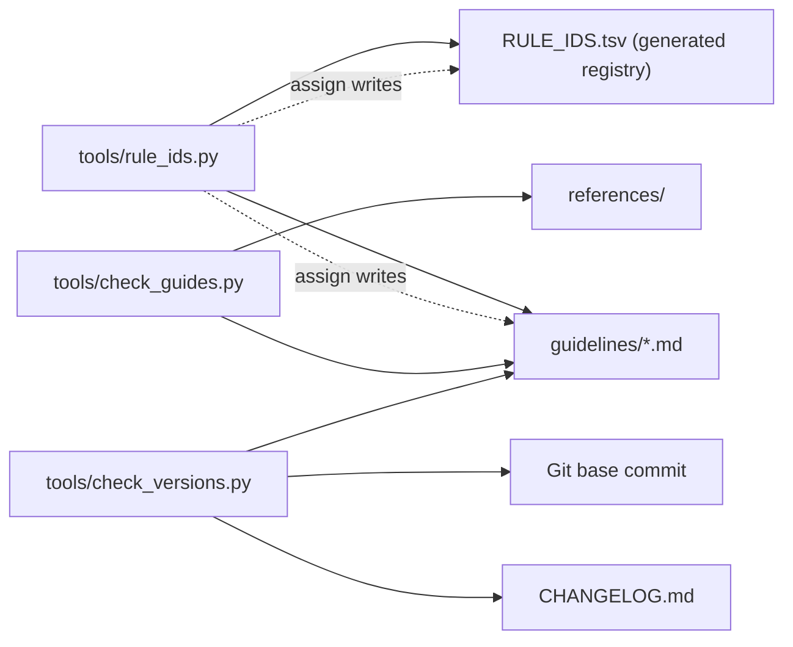

# Code map: agent-coding-guidelines

This repository contains reusable instructions for agents, scientific reference implementations and tools that
check the instructions. Start with the part you want to change; there is no single application entry point.
Installation, supported domains and CI are described in [README.md](README.md).

## Start reading here

1. [Coding guidelines](guidelines/CODING_GUIDELINES.md): §0 explains adoption, precedence and stable rule IDs;
   §2 defines project documents; §4 and §22 cover readable Python and notebooks.
2. [Agentic guidelines](guidelines/AGENTIC_GUIDELINES.md): working scope, evidence and review, separate from
   code organization. Read a domain guide when modifying a scientific rule.
3. [Recipe index](recipes/README.md): locate the implementation of a procedure before editing it.
   For example, `recipes/scrnaseq/normalization.py` explains its public normalization functions in its
   opening docstring; `recipes/scrnaseq/layers.py` owns input-layer selection and output-layer protection.
4. [Guide checker](tools/check_guides.py): start at `main`, then follow the relevant check.
   [Rule registry tool](tools/rule_ids.py): start at `main` for assignment versus validation.
5. [Tool tests](tools/tests/) and [recipe tests](recipes/tests/): locate the behaviour you are changing.

## Responsibilities and dependency boundaries

| Location | Responsibility | Inputs / outputs |
|---|---|---|
| `guidelines/` | Normative rules, identified and versioned per guide | Copied verbatim into downstream projects |
| `references/` | Literature, adaptation notes and upstream tracking | Read by people and applicable validation tools |
| `templates/` | Starting points for project-specific documents | Adapted by the adopting project |
| `tools/rule_ids.py` | Assign/check identifiers | Reads guides; assignment rewrites guides and `RULE_IDS.tsv` |
| `tools/check_guides.py` | Check citations, cross-references, paths and metadata | Reads guides/references; reports problems |
| `tools/check_versions.py` | Check guide version/changelog changes | Reads working tree and a Git base; reports problems |
| `recipes/` | Scientific implementations organized by domain | Typed data structures or documented file interfaces |
| `recipes/tests/` | Behavioural examples and regression checks | Synthetic fixtures; some tests require R |

The diagram is **tool → file it reads**, not execution order. Dotted arrows mark writes by `assign`.
It covers guide maintenance only; it is not a complete graph of recipe imports.



In words: rules are authored in the guides, the registry is generated from them, and the checkers independently
validate identifiers, references and version history. Do not edit the registry as an independent source of rules.

## A rule from edit to validation

`CODE-PROJ-010` in the coding guide defines the human reading route. `tools/rule_ids.py assign` records it as
an active rule associated with `CODING_GUIDELINES.md` in `RULE_IDS.tsv`. `check` verifies the registry agrees
with the guides. The version check compares the updated guide with Git and looks for its changelog heading.

From the repository root with Python 3.12+ and Git available:

```bash
python tools/rule_ids.py assign
python tools/rule_ids.py check
python tools/check_guides.py
python tools/check_versions.py --base HEAD
```

These checks return zero when valid; a successful run may print nothing. Assignment can modify files, so
inspect the diff afterwards. They verify document structure, not whether a scientific rule is correct or a
person understands it. The sequence was run for the 4.2.0 documentation change on 2026-11-16.

## Where to make common changes

| I want to… | Edit here | Check with | Update / downstream impact |
|---|---|---|---|
| Improve readability instructions | `guidelines/CODING_GUIDELINES.md`, relevant existing section | Four commands above | Guide version, changelog, generated registry; downstream copies update explicitly |
| Adapt the reader's map template | `templates/CODE_MAP.template.md` | Inspect placeholders, legend and adoption instructions | Existing projects do not automatically inherit template changes |
| Change a scientific procedure | Domain guide and matching module from `recipes/README.md` | Targeted behavioural tests and a tiny run | Consumers, affected results and corresponding documentation |
| Change a citation/path checker | `tools/check_guides.py` | `pytest tools/tests/test_check_guides.py` | Validation behaviour; add a regression for the changed check |
| Track an upstream source | `references/SOURCE_REPOS.toml` | `pytest tools/tests/test_check_sources.py` | Source-review workflow; see README maintenance section |

## Environments and notebooks

Guide-maintenance scripts above use Python's standard library; the version checker invokes Git.
Recipe runtime libraries and optional groups are declared in [pyproject.toml](pyproject.toml); installation and
R requirements are described in [recipes/README.md](recipes/README.md). Those declarations are the authoritative
inventory. They are not a resolved environment lockfile.

No analysis `.ipynb` files are currently tracked here. The notebook rules apply to adopting projects; the code-map
template includes a notebook route to fill with real headings, functions and file dependencies. No notebook
execution or scientific recipe validation is claimed for this documentation-only change.
