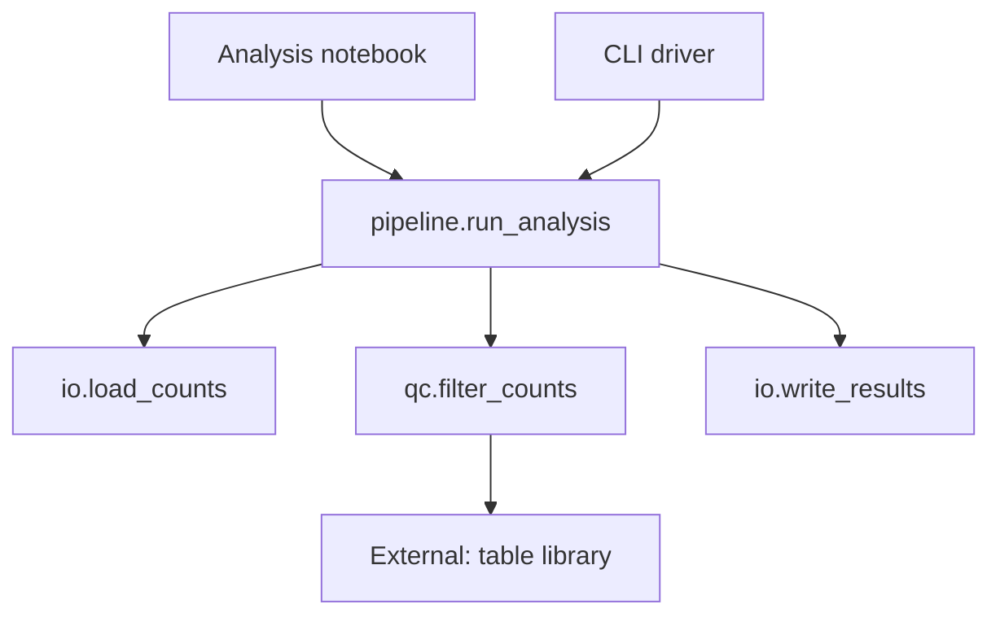

# Code map: <project name>

<!-- Adapt this file into CODE_MAP.md, or use these sections in an existing README/architecture guide.
Replace placeholders with verified project facts and delete these instructions. This is a template,
not an executable example: the illustrative modules below do not exist until replaced by your paths.
Keep this short; omit sections that add no information. Link to contracts instead of copying them. -->

## Purpose and reader

<What problem does this code solve? What domain/Python knowledge is assumed? Define unfamiliar terms.>

Setup and execution: <link to README>. Decisions, schemas and conventions: <link to PROJECT_CONTEXT.md>.

## Start reading here

1. <Notebook heading or CLI entry point>: <question it answers and where parameters enter>.
2. <Module and coordinating function>: <main steps and what it returns>.
3. <Key transformation>: <scientific assumption worth understanding>.
4. <Test or tiny example>: <behaviour it demonstrates and expected result>.

## Responsibilities and boundaries

| File or module | Responsibility | Main entry points | Inputs → outputs / side effects |
|---|---|---|---|
| <real path> | <one sentence> | <symbol names> | <types, files or mutations; link to contracts> |

<Where is the canonical configuration? Which files are generated, vendored or read-only?
What should not depend on what? Link to PROJECT_CONTEXT.md for authoritative constraints.>

## Dependency map

Illustration only: replace every node and edge with verified relationships.
Arrows mean **caller → dependency**. This is a selected call map, not execution order or an exhaustive import graph.



In words: <explain the main path and boundaries so the map is useful without Mermaid rendering>.
External commands or dynamic imports not shown: <identify them, or state none>.

| External library/tool | Why it is needed | Boundary that calls it | Version/API reference |
|---|---|---|---|
| <name> | <role> | <module/function or subprocess> | <environment file and relevant docs> |

## One input-to-output walkthrough

Use one tiny real fixture, not a fabricated production result. Arrows here mean **data becomes/is written as**.

```text
<fixture and schema> -> <loader> -> <validated table>
                    -> <transformation with parameters> -> <result schema> -> <output path>
```

<Describe a concrete record or small table before/after the important step, including units,
row cardinality and what is rejected. Link to the implementing function and test.>

Run from <working directory>, using <environment from README>:

```bash
# Replace with the actual verified command and small input.
<command>
```

Expected: <checkable output, location and how its expectation was established>.
Validation status: <what ran, when, and limits; do not claim the placeholder command works>.

## Common changes

| I want to… | Edit here | Check with | Regenerate / affected consumers |
|---|---|---|---|
| Change an analysis parameter | <configuration key or notebook heading> | <targeted check> | <dependent results> |
| Change a scientific transformation | <module:function> | <test and tiny fixture> | <outputs/notebooks> |
| Add a data source | <loader and schema contract> | <valid/invalid input tests> | <downstream artefacts> |
| Change a plot | <notebook heading or plot function> | <render and inspect> | <figure exports> |

<Keep only relevant rows, with real locations. Explain whether a change alters interpretation or compatibility.>

## Notebook route

| Notebook / section | Question | Prerequisite files | Package functions | Outputs |
|---|---|---|---|---|
| <path / Markdown heading> | <question> | <files; producing command/notebook> | <module:function> | <paths> |

<Execution order and why, or state that the notebooks are independent. Identify the parameters section.
Explain how to restart and run all cells, where execution evidence is stored, and any unavailable data.>

## Troubleshooting and limits

<Known input/environment failures and the first place to inspect. Link to errors/tests rather than inventing
possible failures. Identify expensive steps, unverified routes and limitations of the small example.>

Maintenance: update affected paths, boundaries and change recipes in the same change as the code.
Keep function contracts in docstrings and decision history in the project decisions log.
